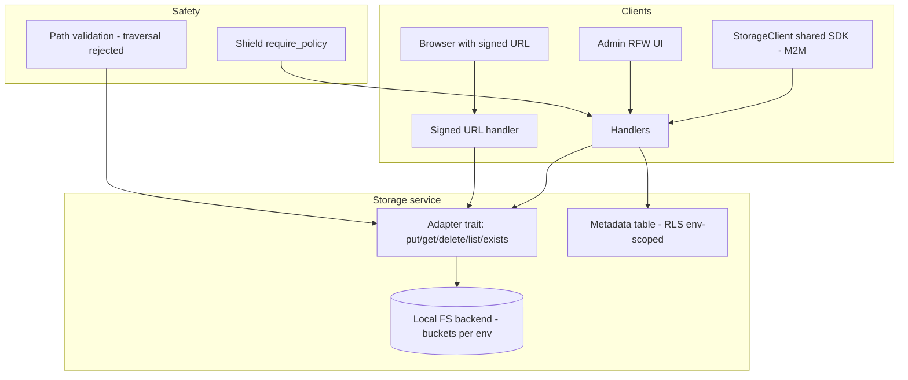

# Design Doc: Sentin8:Storage - Object Storage Service

## 1. Summary

Sentin8:Storage is the platform's object-storage service. Buckets are
per-environment (`{vertical}-*` naming with env-scoped RLS), objects
are written/read/copied/moved/deleted through an M2M-authenticated API,
and time-boxed signed URLs let untrusted clients fetch or upload
without holding platform credentials. Direct PostgreSQL or object-
storage access from domain services is prohibited - everything goes
through the shared Storage client.

## 2. Motivation

- **One object plane.** AI chunk text, trace archives, app uploads,
  and vertical blobs all share one storage plane with tenant-isolated
  bucket semantics - no vertical owns an S3 account or a filesystem.
- **All access requires a token.** Every read/write requires an
  Sentin8:Auth-issued token; signed URLs are the escape hatch for
  unauthenticated consumers (browser uploads/downloads) and are
  time-boxed and auditable.
- **Path traversal is a security invariant.** Keys must stay inside
  their bucket root - traversal attempts are rejected before any IO,
  not sanitized after.
- **Idempotent, content-addressed friendly.** Content-addressed
  verticals (email blobs etc.) short-circuit with `If-None-Match: *`
  / `X-If-Absent: true` and probe with `HEAD` before writing - the
  dedup fast path is a first-class API.

## 3. Architecture & High-Level Design

- **Adapter trait** - `put`/`get`/`delete`/`list`/`exists` (+ default
  `copy`/`move_object` composition); the local FS backend is the
  v1 implementation; S3-style adapters can override with native
  HEAD.
- **Object API** - PUT (idempotent options), GET, HEAD (existence +
  size without payload), DELETE, list by prefix, copy/move.
- **Signed URLs** - token-embedded (not path-embedded) authorization:
  the token carries key + expiry + operation; the handler verifies
  against the current secret and serves/uploads.
- **Env-scoped RLS** - bucket/object metadata tables carry `env_id`;
  the tenant context is set on the same connection inside the same
  transaction.

## 4. Key Traits and Data Structures

- **`StorageAdapter`** - the backend boundary: async `put`/`get`/
  `delete`/`list` with default `exists` (0-byte read probe; native
  HEAD adapters override) and default `copy`/`move_object`
  (read-then-write).
- **`StorageError`** - `NotFound`, `PathTraversal` (rejected before
  any IO), `Io`.
- **`UpsertSecretRequest`-style object contracts** - PUT with
  content-type + optional idempotency hints; GET returns bytes.
- **Signed URL tokens** - HMAC-signed, time-boxed, operation-scoped
  (GET/PUT), single-key scope.
- **Bucket records** - per-env bucket metadata (name, created_by,
  quota).

## 5. Rationale, Trade-offs, and Alternatives

- **Adapter trait over a fixed backend.** The local FS backend ships
  v1; S3-compatible object stores are an adapter away (native HEAD
  and range reads override the defaults). Direct object-store
  access from services would fork credentials and bypass the tenant
  checks.
- **Env-scoped buckets, RLS-enforced.** Bucket keys derive from the
  env; the RLS policy matches `env_id` so even a buggy client cannot
  read across tenants. Explicit `WHERE env_id` clauses remain the
  primary filter.
- **Path traversal rejected pre-IO.** Key normalization happens before
  any file operation - `..` components, absolute paths, and URL-
  encoded traversal are rejected. Post-IO containment (chroot-style)
  would still leak existence probes.
- **Idempotent PUT with conditional hints.** Content-addressed
  verticals probe (HEAD/`exists`) then write with `If-None-Match: *`;
  the dedup fast path avoids double-uploading immutable blobs.
  Unconditional PUT would rewrite identical objects (wasted IO + egress
  on remote backends).
- **Signed URLs as time-boxed capabilities.** A browser upload needs
  write access for one object for minutes - a scoped token beats
  proxying the bytes through the BFF (bandwidth) or granting the
  browser a token (credential exposure).
- **Local FS backend first.** Single-binary deployments (the platform's
  default posture) need no external object store; the adapter keeps
  the S3 path open without depending on it.
- **HEAD-style existence probe.** `exists` avoids reading payloads -
  the fast path every content-addressed vertical uses before writing;
  a read-then-decide flow would ship every byte twice.
- **Rejected: per-vertical storage silos.** Same isolation argument as
  metrics - one plane, one credential owner, one audit surface.
- **Rejected: unauthenticated direct object paths.** Without signed
  URLs, every object read is token-checked; the capability token
  restores convenience without the permanent exposure.

## 6. Internal Implementation & Invariants (Private Design)

- **Invariants:**
  - Every object key is validated against bucket-root containment
    before IO (traversal rejected with a typed error).
  - The tenant context is set on the SAME connection, inside the same
    explicit transaction as every metadata query - a bare-pool SELECT
    returns 0 rows under FORCE RLS (surfaced historically as spurious
    404 "environment not found").
  - Authorization still resolves + validates the effective env even on
    endpoints with explicit path envs - the token's env and the
    requested env must agree (or carry validated cross-env RBAC).
  - Signed URLs expire; expired/unknown tokens are rejected before any
    storage IO.
  - Copy/move preserve content-type metadata; move is copy-then-delete
    (no partial state left on failure - the delete happens after the
    successful copy).
  - Only `sentin8:storage:*` scoped workloads touch objects; the
    admin UI is Shield-gated with the enforced scope-mirror set.
- **Boot (shell-owned).** The shell owns the listener stack; Storage
  builds its capped pool, consumes the Shield engine, initializes the
  bucket directory layout per env, and mounts the object API + admin
  UI (+ shared policy-admin surface).
- **Storage layout.** Objects live under `{data_dir}/{bucket}/{key}`;
  the backend registry (buckets table) maps bucket → env; keys are
  percent-decoded exactly once and re-validated.

## 7. Unresolved Questions / Future Designs

- Multipart uploads ride the storage design's presigned-PUT pattern (N
  presigned part-PUTs + a commit endpoint).
- The S3-compatible backend adapter implements `S3Adapter` behind the adapter
  trait (deliberate future work per storage design §7).
- Per-bucket quota enforcement tracks bytes-per-namespace in the metadata (the
  dedup path already scans sizes).
- Object versioning is a non-goal: the copy-then-delete contract plus the
  audit journal cover the requirement.

---

**Architecture & Design:** sentin8:storage and its underlying concepts were designed by [Hamid Jahanzad](https://www.linkedin.com/in/hamidjahanzad/).
